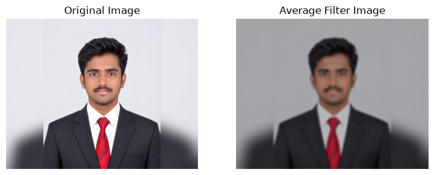
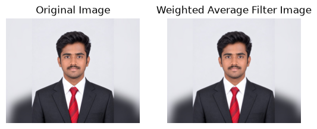
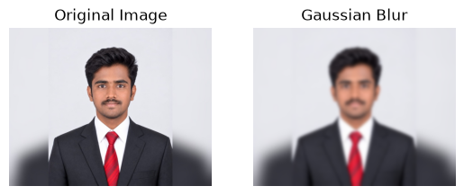
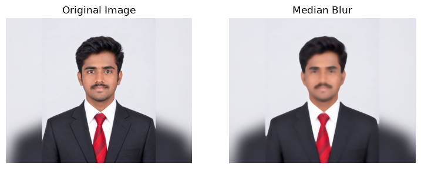
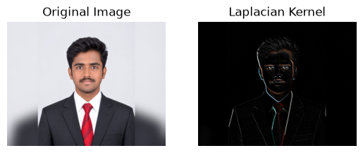
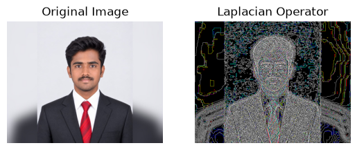

# Experiment 5 – Implementation of Filters

## Name
MUTHUAKASH M

## Register Number
212225230194

## Aim
To implement different image filtering techniques using OpenCV and Python, and to observe the changes produced in an image.

## Software Required
- Python
- Jupyter Notebook
- OpenCV (`cv2`)
- NumPy
- Matplotlib

## Input Image Required
- `Qno. 1.jpg`

Place the input image in the same folder as the Jupyter Notebook or Python program.

## Algorithm

1. Import the required libraries: OpenCV, NumPy, and Matplotlib.
2. Read the input image using `cv2.imread()`.
3. Convert the image from BGR color format to RGB using `cv2.cvtColor()`.
4. Apply an average filter using a kernel and `cv2.filter2D()`.
5. Apply a weighted average filter using a 3 × 3 kernel.
6. Apply Gaussian blur using `cv2.GaussianBlur()`.
7. Apply median blur using `cv2.medianBlur()`.
8. Apply a Laplacian kernel using `cv2.filter2D()`.
9. Apply the Laplacian operator using `cv2.Laplacian()`.
10. Display the original image and each filtered image using Matplotlib.

## Program 1: Average Filter

```python
import cv2
import matplotlib.pyplot as plt
import numpy as np

image1 = cv2.imread("Qno. 1.jpg")
image2 = cv2.cvtColor(image1, cv2.COLOR_BGR2RGB)

kernel = np.ones((11, 11), np.float32) / 169
image3 = cv2.filter2D(image2, -1, kernel)

plt.figure(figsize=(9, 9))

plt.subplot(1, 2, 1)
plt.imshow(image2)
plt.title("Original Image")
plt.axis("off")

plt.subplot(1, 2, 2)
plt.imshow(image3)
plt.title("Average Filter Image")
plt.axis("off")

plt.show()
```



## Program 2: Weighted Average Filter

```python
kernel1 = np.array([[1, 2, 1],
                    [2, 4, 2],
                    [1, 2, 1]]) / 16

image2 = cv2.cvtColor(image1, cv2.COLOR_BGR2RGB)
image3 = cv2.filter2D(image2, -1, kernel1)

plt.subplot(1, 2, 1)
plt.imshow(image2)
plt.title("Original Image")
plt.axis("off")

plt.subplot(1, 2, 2)
plt.imshow(image3)
plt.title("Weighted Average Filter Image")
plt.axis("off")

plt.show()
```


## Program 3: Gaussian Blur

```python
gaussian_blur = cv2.GaussianBlur(image2, (33, 33), 0, 0)

plt.subplot(1, 2, 1)
plt.imshow(image2)
plt.title("Original Image")
plt.axis("off")

plt.subplot(1, 2, 2)
plt.imshow(gaussian_blur)
plt.title("Gaussian Blur")
plt.axis("off")

plt.show()
```


## Program 4: Median Blur

```python
median = cv2.medianBlur(image2, 13)

plt.figure(figsize=(9, 9))

plt.subplot(1, 2, 1)
plt.imshow(image2)
plt.title("Original Image")
plt.axis("off")

plt.subplot(1, 2, 2)
plt.imshow(median)
plt.title("Median Blur")
plt.axis("off")

plt.show()
```


## Program 5: Laplacian Kernel

```python
kernel2 = np.array([[-1, -1, -1],
                    [ 2, -2,  1],
                    [ 2,  1, -1]])

image3 = cv2.filter2D(image2, -1, kernel2)

plt.subplot(1, 2, 1)
plt.imshow(image2)
plt.title("Original Image")
plt.axis("off")

plt.subplot(1, 2, 2)
plt.imshow(image3)
plt.title("Laplacian Kernel")
plt.axis("off")

plt.show()
```


## Program 6: Laplacian Operator

```python
laplacian = cv2.Laplacian(image2, cv2.CV_64F)

plt.subplot(1, 2, 1)
plt.imshow(image2)
plt.title("Original Image")
plt.axis("off")

plt.subplot(1, 2, 2)
plt.imshow(laplacian)
plt.title("Laplacian Operator")
plt.axis("off")

plt.show()
```



## Result


Thus, different image filtering techniques such as Average Filter, Weighted Average Filter, Gaussian Blur, Median Blur, Laplacian Kernel, and Laplacian Operator were implemented successfully using OpenCV and Python.

The filtered images were displayed and compared with the original image to observe the effects of smoothing and edge enhancement.

